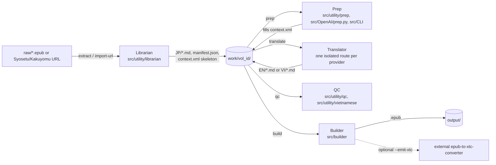

# Architecture Map — LLM Translator

Maintainer-level map of the codebase. It names modules and functions, never
line numbers (those rot on the next edit). Model ids, prices and limits are
deliberately not repeated here: `config.yaml` is the source of truth for what
each route calls, `src/Deepseek/common/token_telemetry.py` (+
`deepseek_pricing.json`) for what it costs.

## Scope

A standalone, self-contained pipeline: **extract → prep → translate → qc →
build**, Japanese → English or Vietnamese. It is not the larger "MTL Studio"
pipeline some comments still mention (no vector stores, no RAG modules, no
multi-model QC fan-out); terminology overlaps (`context.xml`, `manifest.json`,
`work/<volume_id>/`) but nothing is shared.

### Coding-agent harness (2026-11-17 addition)

`scripts/harness.py` and `src/harness/` provide a development-only control loop:
read repository progress/feature state → make a bounded change → run checks →
record evidence tied to the source snapshot → write a handoff. `AGENTS.md` is
the shared instruction entry point and `CLAUDE.md` delegates to it.

Session continuity uses plain repository files: `harness/progress.md`,
`harness/features.json` and `harness/handoff.md`. There is no separate database,
retrieval index or external service. Translation providers, prompt builders and
Vietnamese bibles are independent of this development workflow.

See `harness/README.md` for setup and current evidence. This coding harness is
distinct from `src/Deepseek/mcp/harness.py`, which exposes MCP persona/routing
resources. Detailed historical line numbers below may need re-anchoring after
later changes; use current code and harness evidence to verify claims.

## Pipeline



`mtl.py run <epub|url>` chains every phase; `resume <vol>` runs only what the
manifest says is unfinished. Each phase is also independently invocable.

## Directory Map

```
scripts/mtl.py              CLI entry point (see Entry Points)
mtl.bat / mtl.sh            Python CLI launchers (interpreter resolution, dep auto-install)
mtl-ts.bat / mtl-ts.sh      TypeScript console launchers
config.yaml                 Master runtime config
src/
  Deepseek/
    common/                 CROSS-PROVIDER infrastructure despite the package name:
                            config, language, llm_types, token_telemetry, atomic_io,
                            safety_fallback, chapter_signals, verbatim_anchors,
                            structural_fidelity, illustration_reinjection
    translator/             DeepSeek route + shared helpers (provider.py dispatch table,
                            thinking_output, thinking_density, dry_run)
    prompt/                 DeepSeek master prompt + the prep prompt
    mcp/                    MCP server, harness, runtime, servers/*.py
  Qwen/ OpenAI/ Anthropic/ Gemini/   One isolated route each
  CLI/                      Codex CLI / Claude Code route (subscription, no API key)
  prompts/vi/               Vietnamese master prompt (shared by openai/gemini/codex/claude)
  utility/
    librarian/              Phase 1: EPUB extraction
    prep/                   context.xml builder (DeepSeek paths + web-search chain)
    qc/                     English filesystem-only gate
    vietnamese/             VI bible, analysis, QC, alignment, repair, assistant
    webimport/              Syosetu / Kakuyomu import -> JP EPUB -> Librarian
  builder/                  Phase 4: EPUB assembly, device profiles, XTC export
tests/                      unit/ + integration/ (pytest, offline by default)
ts/                         Ink/React operator console (pure client)
fonts/                      Literata + Inter, embedded in Vietnamese EPUBs
```

`raw/`, `work/`, `output/`, `bibles/` are created at run time and gitignored.

## Target Languages (`src/Deepseek/common/language.py`)

A workspace is bound to one target language at extraction
(`manifest.json` → `runtime_config.target_language`; `context.xml` root
attribute). Every later phase resolves paths and prompts from the workspace,
never from the global default: `translated_path()` gives `EN/<id>_EN.md` or
`VI/<id>_VI.md`; `resolve_master_prompt()` returns the provider's own prompt
for English and `project.languages.<lang>.providers.<provider>.master_prompt`
otherwise; `require_provider_support()` refuses an undeclared
language/provider pair before any API call (DeepSeek, Qwen and Anthropic call
it in `translate_volume`; OpenAI, Gemini and CLI in their translator
constructors; the MCP `translate_chapter` tool checks it itself).

English-only mechanisms are gated on the language: verbatim anchors, the
CJK-strip (Gemini, OpenAI) and the DeepSeek safety fallback. The per-chapter
`<vietnamese_localization>` block comes from `target_language_block()` and
goes in the chapter message, so the cached system prefix stays stable.

## Phase 1 — Librarian (`src/utility/librarian/`)

`run_librarian()` → `LibrarianAgent.process_epub()`: `EPUBExtractor` →
`MetadataParser` → `TOCParser`/`SpineParser` → publisher-profile spine
heuristics → `XHTMLToMarkdownConverter` → image cataloging → `Manifest` +
`context.xml` skeleton (`_write_context_placeholder`). Deterministic, zero LLM
calls. `agent.py` also has its own `-m` CLI entry, used by the MCP server's
subprocess shell-out.

| Module | Purpose |
|---|---|
| `epub_extractor.py` | Zip extraction, working-dir layout, OPF metadata for `<opf_metadata>` |
| `metadata_parser.py` | OPF title/author/language, sequel detection |
| `spine_parser.py` / `toc_parser.py` | Reading order and TOC/NCX parsing |
| `xhtml_to_markdown.py` | Ruby/furigana handling, clean markdown output |
| `content_splitter.py` | Token-budget and Kodansha-format chapter splitting |
| `image_extractor.py`, `gaiji.py` | Cover/kuchie/illustration cataloging, gaiji glyph mapping |
| `publisher_profiles/` | Publisher detection + per-publisher patterns (JSON profiles) |

## Prep — context.xml Builder

`src/utility/prep/agent.py::run_prep(volume_id, series_id, force_rerun, provider)`
dispatches on `prep.provider` (or `--prep-provider`):

| Provider | Implementation |
|---|---|
| `deepseek` | `multiturn_agent.run_multiturn_prep` when `prep.multi_turn.enabled` (the default path): one persisted sequential conversation, one JSON-node turn per block in `block_prompts.MULTITURN_BLOCK_ORDER` (16 blocks), deterministic atomic assembly. `parallel_agent` is an explicitly selected alternative, mutually exclusive with multi-turn. |
| `openai` | `src/OpenAI/prep.py::run_openai_prep` — same prompt and block schemas through Responses, optionally as one durable Batch job |
| `codex` / `claude` | `src/CLI/` — one long CLI call |

Any other value raises `PrepError`. The active path fails closed: a turn or
assembly error keeps its JSON artifacts for an explicit retry and never
silently launches (and bills) a second strategy. Prep deliberately does not
reuse `DeepSeekClient`. All paths converge on `_finalize_and_write`, which
writes `context.xml` atomically, updates `manifest.json.pipeline_state.prep`
and extracts `TRANSLATION_BRIEF.md`. `web_search_chain.py` resolves
title/author metadata against an allowlisted set of hosts before the
conversation starts.

Sequel detection (`discover_series_bible`) matches the volume's JP title
against `bibles/<series_id>/series_pack.json` and injects that bible.

## Phase 2 — Translator

### Dispatch

`src/Deepseek/translator/provider.py` is the single table: `API_PROVIDERS`
(deepseek, qwen, openai, anthropic, gemini) and `CLI_PROVIDERS` (codex,
claude). `get_volume_translator()` returns the route's `translate_volume`;
`get_translator_class()` returns the per-chapter class (API routes only).
`scripts/mtl.py` and the MCP translator tools both go through it.

### Isolated-route convention

Each API provider is a self-contained package `src/<Provider>/`: `client.py`
(request construction + retry), `config.py`, `prompt_loader.py`,
`conversation.py` (replay/persistence ledger), `errors.py`, `context.py`
(context.xml parsers), `optimization.py` (chapter guidance), `agent.py`
(`<Provider>Translator` + `translate_volume`), `prompts/`. There is **no
shared base class**, and each route's `context.py` owns its own parsers —
duplication is the deliberate price for one route's change never altering
another's behaviour. Extra modules: OpenAI `batch.py`, `prep.py`,
`response.py`; Anthropic `batch.py`, `response.py`, `advisor_prompts.py`;
Gemini `batch.py`, `caching.py`, `response.py`.

`src/CLI/` is different by nature: stateless one-process-per-call, chapters
split at paragraph boundaries, continuity from the previous chapter's tail.

### Shared infrastructure (all under `src/Deepseek/`)

`common/llm_types.py` (the normalized `LLMResponse`/`LLMUsage` contract),
`common/chapter_order.py` (story-order sort and predecessor lookup — never
sort chapter files with plain `sorted()`: `CHAPTER_100` sorts before
`CHAPTER_11`), `common/config.py` (`cfg_int`/`cfg_float` keep an explicit `0`
that `x.get(k, d) or d` would discard), `common/token_estimate.py` (CJK-aware
token estimate for the conversation ledgers' compaction ladders — `len // 4`
under-counts Japanese ~2.5x),
`common/token_telemetry.py` (pricing + `log_call()` →
`work/<vol>/LOG/token_log_<stamp>.md`), `common/atomic_io.py`,
`common/safety_fallback.py` (a non-DeepSeek content refusal hands the chapter
to DeepSeek with the established decisions inherited),
`translator/thinking_output.py`, `translator/thinking_density.py`
(`THINKING/density_map.html`), `translator/dry_run.py`.

## QC

`src/utility/qc/agent.py::run_qc(volume_id, llm, dry_run, chapters, assistant_provider)`.
English: filesystem-only, zero API calls — output existence, truncation
heuristic, JP:EN token-ratio outliers, structural flags, locked-name drift.
Vietnamese: delegates to `src/utility/vietnamese/qc.py::run_vi_qc`
(deterministic checks; `llm=True` adds the semantic review through
`assistant.py`). `repair.py` applies mechanical or LLM paragraph repairs.

## Phase 4 — Builder (`src/builder/`)

`run_builder()` → `BuilderAgent.build_epub()`: load manifest → build OEBPS
tree → convert markdown → copy/optimize images → nav/OPF →
`EPUBPackager.package_epub` → structure validation (`validation.py`, optional
epubcheck) → optional XTC export.

`device_profiles.py` is the single registry (`passthrough`, `standard`,
`xteink-x3`, `xteink-x4`). `resolve_profile()` fails eagerly on an unknown
name and overlays `builder.images` on the `standard` profile; the xteink
profiles derive everything from the panel. `device_budgets.py` only warns.
`xtc_export.py` delegates to an external, never-vendored Node converter; a
failed export never fails the build, and it runs only when `--emit-xtc` /
`emit_xtc=` is passed (`builder.xtc.enabled` is advisory, read by no code).

Embedded fonts are per language (`project.languages.<lang>.epub_fonts`).

## Entry Points

### CLI (`scripts/mtl.py`)

`extract`, `import-url`, `prep`, `translate`, `qc`, `repair`, `bible-vi`,
`build`, `run`, `resume`, `list`, `status` — `python scripts/mtl.py -h` and
the README's CLI Reference are authoritative for flags.

**Interpreter policy.** `mtl.bat`, `mtl.sh` and
`ts/src/core/mtls.ts::pythonCommand` honour `LLM_TRANSLATOR_PYTHON` first and
otherwise use the system `python`/`python3`. They deliberately carry no
project-venv probe: the launchers auto-`pip install` into whatever they
resolve, so a probe would install runtime dependencies into the test
environment. The project venv is for development and tests:
`<venv>/Scripts/python -m pytest` (needs `requirements-dev.txt`).

### MCP server (`src/Deepseek/mcp/`)

`server.py::create_mcp_server()` (MCP Python SDK 2.x `MCPServer`;
stdio/http/sse via `MCP_TRANSPORT`). Six tool modules under `servers/`:
librarian (8 tools), prep (1), translator (2), qc (1), bible (1), builder (7)
— 20 tools, mirrored by `ts/src/core/capabilities.ts::MCP_TOOL_OVERLAY`.
`harness.py` exposes two resources: `persona://instructions` (the project's
local `CLAUDE.md`, empty when absent) and `routing://phases` (overridable by a
`phase_routing:` section in `config.yaml`). `mcp_config.py` owns the path
allowlist and `redact_config()`.

### TypeScript console (`ts/`)

Pure client, no pipeline logic. Capabilities route through (a) a CLI
subprocess for extract/prep/translate/qc/build/run, (b) MCP stdio for the 20
tools, or (c) local filesystem reads for dashboard views.
`core/configSchema.ts` mirrors the editable `config.yaml` leaves (a path that
does not exist in the file silently fails to bind — keep them in sync);
`core/configFile.ts` rewrites one line in place per edit.
`core/deepseekPricing.ts` reads the same `deepseek_pricing.json` as Python.

## Config Reference (`config.yaml` top-level keys)

| Key | Read by |
|---|---|
| `project` | `language.py` (target language, `languages.<lang>`: providers, fonts, bible, qc) |
| `assistant` | `src/utility/vietnamese/assistant.py` |
| `cli` | `src/CLI/runner.py` |
| `web_import` | `src/utility/webimport/` |
| `prep` | `src/utility/prep/`, `src/OpenAI/prep.py` |
| `translation` | each route's `config.py`; `thinking_log` and `safety_fallback` are shared |
| `builder` | `src/builder/config.py` (`device_profile`, `images`, `xtc`, `epubcheck_jar`) |
| `qc` | Not read by Python; locates calibration material for the local translation-evaluator skill |
| `phase_routing` (optional) | `mcp/harness.py` |
| `os_detection` (optional, absent) | `common/os_config.py` — per-OS directory overrides |

## Testing

`pytest` from the repo root (`pytest.ini`: `testpaths = tests`). `tests/unit`
covers language/prompt selection, the CLI providers, the Vietnamese bible, QC
and repair, web import, pricing and provider dispatch, chapter ordering and
the re-extraction guard; `test_console_mirrors.py` fails when a table the
TypeScript console hand-mirrors (advisor pairings, MCP tools, config paths,
providers, device profiles) drifts from Python.
`tests/integration/test_pipeline_offline.py`
drives the real OpenAI and Gemini agents through a scripted client;
`test_live_sites.py` is skipped unless `MTL_LIVE_NETWORK=1`. Nothing in the
default run calls a paid API.

Coverage gaps: the DeepSeek, Qwen and Anthropic routes, the Librarian and the
Builder have no dedicated tests; the TypeScript console has no runner of its
own (`npm run typecheck` plus the pytest mirror checks above).

## Known Gaps

- **`src/utility/bible/` is missing from the repository.** An unanchored
  `bible/` rule in `.gitignore` excluded it from every commit (now `/bible/`).
  `mcp/servers/bible_server.py` imports it lazily, so only the `write_bible`
  tool is unavailable until the package is committed.
- **Local-only agent assets.** `.github/`, `.agents/`, `AGENTS.md`,
  `CLAUDE.md` are gitignored by design. `scripts/convert_agent_assets.py`,
  `scripts/validate_agent_assets.py` and `workflows/qc-gate.wf.mjs` operate on
  them and do nothing in a checkout without them.
- **Inherited helpers.** Several modules copied from the larger pipeline keep
  a few functions nothing here calls (e.g. in `builder/` and
  `librarian/`, cache-management stubs on `DeepSeekClient`).

## Maintenance Recipes

### Adding a provider route

1. Scaffold `src/<Provider>/` mirroring the existing package of the same wire
   family (Responses, Messages or Interactions).
2. Add a `translation.<provider>:` block to `config.yaml`.
3. Add one row to `API_PROVIDERS` in `src/Deepseek/translator/provider.py`.
4. Price it in `token_telemetry.py` (an unknown model must never estimate low).
5. Console: add field specs to `ts/src/core/configSchema.ts`, the provider to
   the regexes in `preflight.ts` / `mtls.ts`, and a row to `pricing.ts`.
6. For a non-English target, declare it under
   `project.languages.<lang>.providers` and call `require_provider_support`.
7. Add tests in the style of `tests/integration/test_pipeline_offline.py`.

### Adding a device profile

Add an entry to `PROFILES` in `src/builder/device_profiles.py`. The CLI's
`--profile` choices read the registry; the console's choice lists
(`capabilities.ts::PROFILE_CHOICES`, `configSchema.ts::DEVICE_PROFILE_CHOICES`)
are hand-mirrored.

### Debugging a translation failure

Check `work/<vol>/manifest.json` (`pipeline_state`, per-chapter
`translation_status` / `last_failure`) and `work/<vol>/LOG/token_log_*.md`.
`translate --dry-run` writes the exact assembled request to
`work/<vol>/DRY_RUN/` at zero API cost. Reasoning is archived per chapter in
`work/<vol>/THINKING/` when `translation.thinking_log.enabled`.
